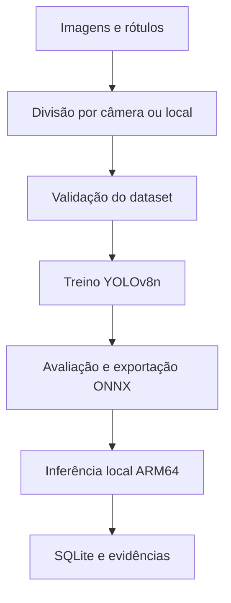

# Monitoramento de animais com visão computacional

MVP do projeto de TCC para detectar animais em câmera, vídeo ou imagens sem depender de
nuvem. O fluxo treina um baseline YOLOv8n, exporta para ONNX e executa a inferência com
ONNX Runtime. Avistamentos confirmados são salvos em SQLite, com imagem de evidência.

O código segue as decisões dos relatórios: poucas classes, arquitetura modular, validação
inicial em QEMU/ARM64 e integração com hardware físico apenas depois que o pipeline estiver
funcional.

As classes configuradas (`anta`, `tamandua_bandeira` e `onca_pintada`) são exemplos. Elas
podem ser substituídas em `config/dataset.yaml` sem alterar o restante do sistema.

## Arquitetura



O ambiente de treinamento usa Ultralytics/PyTorch. O ambiente alvo não precisa de
PyTorch: recebe somente o `.onnx`, OpenCV, NumPy e ONNX Runtime.

## O que está implementado

- separação reprodutível em treino, validação e teste, preservando grupos de uma mesma
  câmera, local ou vídeo;
- validação de rótulos YOLO, IDs de classe, coordenadas, classes ausentes, desbalanceamento
  e arquivos duplicados entre splits;
- treinamento YOLOv8n configurado por YAML e manifesto de experimento;
- avaliação com mAP50-95, mAP50, mAP75, precisão, recall e tempo por etapa;
- exportação ONNX com metadados e SHA-256;
- inferência ONNX em câmera, vídeo, imagem ou diretório;
- NMS por classe, restauração correta das caixas após letterbox e suporte às saídas YOLO
  brutas ou end-to-end;
- confirmação por quadros consecutivos e cooldown para reduzir eventos duplicados;
- banco SQLite, evidências JPEG, vídeo anotado e benchmark de latência/FPS/RAM;
- smoke test ARM64 com QEMU via Docker Buildx e opção de máquina virtual ARM64 completa;
- simulação de ambiente embarcado via Docker nativo com limites de CPU/RAM (cgroups);
- 12 testes unitários sem depender de dataset ou pesos reais.

O dataset e o modelo treinado não estão incluídos por tamanho e licença.

## Instalação

Use Python 3.10 ou superior.

### Ambiente de treinamento

```bash
python3 -m venv .venv
source .venv/bin/activate
python -m pip install --upgrade pip
python -m pip install -e ".[train]"
```

### Ambiente apenas para inferência

```bash
python3 -m venv .venv
source .venv/bin/activate
python -m pip install --upgrade pip
python -m pip install -e .
```

## Pipeline completo

### 1. Organizar o dataset bruto

Os arquivos brutos devem ter imagens e rótulos de mesmo nome:

```text
raw/
├── images/cam01_20260804_frame0001.jpg
└── labels/cam01_20260804_frame0001.txt
```

Divida sem colocar quadros da mesma captura em splits diferentes:

```bash
animal-monitor split-dataset \
  --images raw/images \
  --labels raw/labels \
  --output data/animals \
  --group-regex '(cam[0-9]+_[0-9]{8})_'
```

O primeiro grupo da expressão regular identifica a captura. Se os nomes forem diferentes,
ajuste a expressão para representar `camera + local + data` ou o ID do vídeo.

### 2. Validar antes de treinar

```bash
animal-monitor validate-dataset \
  --data config/dataset.yaml \
  --json-output outputs/dataset_report.json
```

Erros bloqueiam o treinamento. Avisos mostram pontos que precisam de revisão, mas não
interrompem o baseline.

### 3. Treinar o baseline

```bash
animal-monitor train --config config/train.yaml
```

Os resultados ficam em `runs/train/baseline_yolov8n/`. O arquivo
`experiment_manifest.json` registra configuração, ambiente e relatório do dataset.

### 4. Avaliar no conjunto de teste

Use `val` durante ajustes. Reserve `test` para o resultado final.

```bash
animal-monitor evaluate \
  --weights runs/train/baseline_yolov8n/weights/best.pt \
  --data config/dataset.yaml \
  --split test \
  --output outputs/evaluation.json
```

### 5. Exportar para ONNX

```bash
animal-monitor export \
  --weights runs/train/baseline_yolov8n/weights/best.pt \
  --data config/dataset.yaml \
  --output-dir models \
  --imgsz 640
```

Serão criados `models/animal_detector.onnx` e `models/model_metadata.json`.

### 6. Executar o monitoramento

Vídeo:

```bash
animal-monitor infer \
  --model models/animal_detector.onnx \
  --source amostra.mp4 \
  --data config/dataset.yaml \
  --runtime config/runtime.yaml \
  --output-video outputs/amostra_anotada.mp4
```

Câmera USB de índice zero:

```bash
animal-monitor infer \
  --model models/animal_detector.onnx \
  --source 0 \
  --show
```

Em sistema sem interface gráfica, não use `--show`. Os eventos continuam sendo gravados
em `outputs/events.sqlite3`.

### 7. Medir desempenho

```bash
animal-monitor benchmark \
  --model models/animal_detector.onnx \
  --source amostra.mp4 \
  --frames 200 \
  --output outputs/benchmark.json
```

O resultado contém latência média, p50, p95, FPS estimado e pico de memória do processo.

## Validação ARM64/QEMU

### Smoke test rápido

O comando abaixo constrói e executa uma imagem `linux/arm64`. Em uma máquina x86_64, o
Docker Buildx usa QEMU/binfmt para executar o contêiner ARM64:

```bash
./scripts/qemu_arm64_smoke.sh
```

Se o host ainda não tiver QEMU/binfmt registrado, configure o suporte a multiplataforma
conforme a documentação do Docker antes de executar o script.

### Sistema Linux ARM64 completo

Com uma imagem Linux ARM64 inicializável em formato QCOW2:

```bash
export ANIMAL_MONITOR_QEMU_IMAGE=/caminho/debian-arm64.qcow2
export ANIMAL_MONITOR_QEMU_EFI=/caminho/AAVMF_CODE.fd  # opcional se detectado
./scripts/qemu_system_arm64.sh
```

A VM usa a máquina genérica `virt`, CPU Cortex-A72, 4 vCPUs, 2 GB de RAM e encaminha a
porta SSH da VM para `localhost:2222`. Credenciais e preparação da imagem dependem da
distribuição escolhida.

QEMU serve para validar instalação e compatibilidade ARM64. Não use o FPS do emulador como
resultado da Raspberry Pi 5 ou da MaixCAM; a medição final precisa ser feita na placa real.

### Simulação de recursos embarcados (Docker nativo com limites de CPU/RAM)

Complementar ao QEMU (que valida compatibilidade de ISA ARM64), este método testa o modelo
rodando **nativamente** (sem emulação de instruções) mas com CPU e RAM **artificialmente
limitados** via cgroups do Docker, aproximando as restrições de um dispositivo embarcado:

```bash
# Defaults: 4 CPUs, 4GB RAM (aproximando Raspberry Pi 5)
make sim-embedded

# Customizar recursos
SIM_CPUS=2.0 SIM_MEMORY=2g SIM_THREADS=2 make sim-embedded

# Ou rodar o script diretamente
./scripts/docker_resource_sim.sh
```

O script constrói uma imagem Docker nativa, executa `animal-monitor-b benchmark` nos 3 vídeos
de `samples/` com os limites especificados e salva os resultados em `outputs/sim_embedded/*.json`.

**Diferenças entre os métodos de validação:**

| Aspecto | QEMU (ARM64) | Simulação de recursos (este) | Hardware real |
|---|---|---|---|
| ISA | ARM64 emulada | x86_64 nativa (ou ARM nativa) | ARM64 real |
| Velocidade | Muito lento (ordens de magnitude) | Nativa (rápida) | Nativa |
| CPU/RAM limitados | Não | Sim (via cgroups) | Naturalmente |
| Valida | Compatibilidade de arquitetura | Impacto de restrições de recursos | Tudo |
| FPS transferível? | **Não** | Indicativo, mas **não** | **Sim** |

**Limitações da simulação de recursos Docker:**
- **NÃO simula:** ISA ARM, cache L1/L2/L3, largura de banda de memória, throttling térmico,
  NPU (SG2002/MaixCAM), consumo de energia, câmera real, sensores
- Os valores de FPS/latência são **indicativos** de "o modelo funciona com N CPUs e M GB de RAM?",
  mas **NÃO substituem** medição em hardware real
- Útil para: comparar impacto de diferentes configurações de threads, detectar gargalos de
  paralelismo, estimar se o modelo cabe em RAM limitada, testar antes de ter acesso ao hardware

## Modelo B: arquitetura alternativa em dois estágios

Além do baseline descrito acima (Modelo A), o repositório inclui um segundo modelo
independente, em `src/animal_monitor_b/`, com CLI própria (`animal-monitor-b`). Ele separa
a detecção da classificação: um detector YOLOv8n de **uma classe** (`animal`) a 416 px
localiza, um **MobileNetV2** de 128 px decide a espécie sobre o recorte, um rastreador
ByteTrack-lite dá identidade a cada indivíduo e a espécie sai de uma votação com quórum.

Resultado no split `test`, medido com o mesmo código de métrica para os dois modelos:

| Modelo | mAP50 | Precisão | Recall | FPS | Tamanho |
|---|---:|---:|---:|---:|---:|
| Modelo A (640, 3 classes, FP32) | 0.842 | 0.895 | 0.850 | 15.9 | 11.7 MB |
| Modelo B (416 + MobileNetV2, FP32) | **0.897** | **1.000** | **0.900** | **31.1** | 20.1 MB |
| Modelo B INT8 | 0.802 | 0.889 | 0.800 | **35.2** | **5.7 MB** |

FPS medido com `intra_op_threads: 4` para os três, no mesmo hardware x86_64 e nos mesmos
vídeos. Não representa Raspberry Pi 5 nem MaixCAM.

O Modelo B eliminou os dois eventos de espécie errada que o Modelo A produziu nos vídeos de
amostra. Projeto, resultados completos, achados sobre quantização INT8 e limitações estão
em [`docs/MODELO_B.md`](docs/MODELO_B.md).

```bash
python -m pip install -e ".[modelo-b]"
./scripts/modelo_b_pipeline.sh
```

## Configurações principais

- `config/dataset.yaml`: caminhos e nomes das classes;
- `config/train.yaml`: modelo, épocas, imagem, batch, seed e aumentos;
- `config/runtime.yaml`: confiança, IoU, confirmação, cooldown, banco e provider ONNX;
- `config/modelo_b/`: configurações do Modelo B (detector, classificador e execução);
- `MELHORIAS.md`: prioridades técnicas e matriz de experimentos para o TCC;
- `docs/MODELO_B.md`: projeto e resultados do Modelo B.

## Verificação do código

```bash
./scripts/check.sh
```

Ou:

```bash
PYTHONPATH=src python3 -m unittest discover -s tests -v
```

## Limitações atuais

Estas limitações descrevem o Modelo A. Algumas são endereçadas pelo Modelo B
(rastreamento, INT8, rejeição de não-alvo); veja `docs/MODELO_B.md`.

- não há rastreamento de indivíduos; o sistema registra presença por classe;
- não há interface QML; os resultados ficam no SQLite e em arquivos;
- INT8 não é aplicado automaticamente, pois precisa de calibração e comparação de mAP;
- QEMU não reproduz sensor, energia, temperatura ou desempenho do hardware real;
- a confiabilidade final depende do dataset, que ainda precisa ser fechado e revisado.

## Documentação oficial usada como referência

- [Treinamento Ultralytics YOLO](https://docs.ultralytics.com/modes/train/)
- [Formato de datasets de detecção](https://docs.ultralytics.com/datasets/detect/)
- [Exportação de modelos Ultralytics](https://docs.ultralytics.com/modes/export/)
- [ONNX Runtime com Python](https://onnxruntime.ai/docs/get-started/with-python.html)
- [Máquina ARM `virt` do QEMU](https://www.qemu.org/docs/master/system/arm/virt.html)
- [Build multiplataforma com QEMU](https://docs.docker.com/build/building/multi-platform/)
