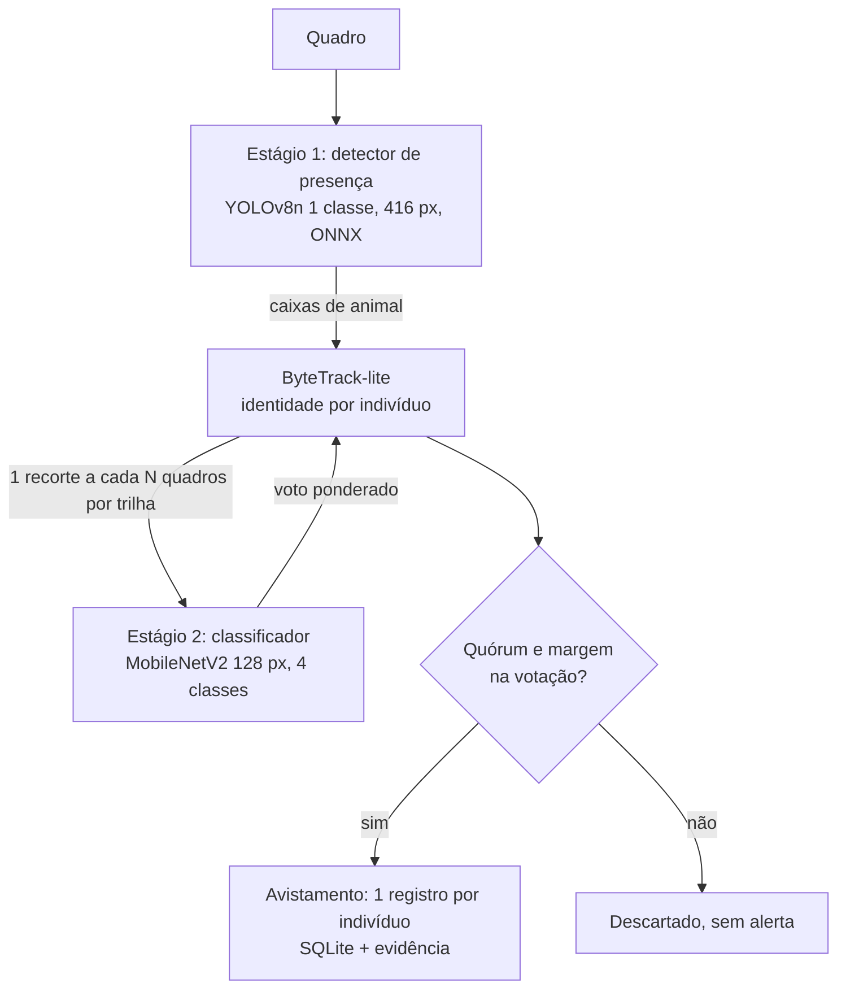

# Modelo B — detecção de presença + classificação de espécie

Arquitetura alternativa à do Modelo A (`animal_monitor`), implementada em pacote separado
(`animal_monitor_b`) para que as duas possam ser comparadas no mesmo dataset, com o mesmo
código de métrica, sem que nenhuma altere a outra.

O código do Modelo A não foi modificado. O Modelo B reaproveita dele apenas utilidades
puras: leitura de fontes de vídeo (`sources.py`), letterbox/NMS/decodificação YOLO
(`inference/prepost.py`) e os tipos `BoundingBox`/`Detection`.

---

## 1. Diagnóstico que motivou o Modelo B

Medições no dataset e nos resultados existentes:

| Constatação | Evidência |
|---|---|
| O dataset é pequeno | 180 imagens, 207 caixas, 147 delas em treino |
| **Não é um dataset de armadilha fotográfica** | área relativa mediana das caixas = **0.47**: o animal ocupa metade do quadro. São fotos em close, não capturas de câmera de trilha |
| A localização é a parte fácil | detector de presença (1 classe) alcança **mAP50 = 0.982** no teste |
| A espécie é a parte difícil | o Modelo A confunde: "anta" com conf. 0.73 no vídeo de lobo-guará e 0.42 no de tamanduá (`outputs/relatorio_validacao.md`, seção 6) |
| Não existe opção de recusar | a cabeça YOLO do Modelo A é obrigada a escolher entre 3 espécies; não há classe "nenhuma delas" nem exemplos negativos |
| O alerta não conhece indivíduos | `DetectionGate` (`events.py:12`) conta 3 quadros consecutivos por classe; um falso positivo persistente por 3 quadros vira evento confirmado |

Conclusão: com 147 caixas divididas em 3 classes, treinar uma cabeça de detecção
multiclasse gasta o pouco dado disponível no problema errado. O Modelo B separa as duas
tarefas e aplica a cada uma a ferramenta adequada.

## 2. Arquitetura



### Estágio 1 — detector de presença (uma classe)

As três espécies colapsam em `animal`. As 147 caixas de treino passam a somar no mesmo
objetivo em vez de se dividir. A entrada cai de 640 para 416 px: 416² são ~42% dos MACs de
640², e detectar um animal que ocupa 47% do quadro não exige a resolução maior.

### Estágio 2 — classificador de espécie

Recortes com 12% de margem de contexto, redimensionados para 128×128, classificados em
**4 classes**: as 3 espécies mais `desconhecido`. A classe `desconhecido` é o mecanismo de
rejeição explícito, treinada com dois tipos de negativo gerados automaticamente:

* **fundo**: caixas sorteadas na imagem com IoU < 0.10 contra todas as caixas reais;
* **recortes desalinhados**: caixas deslocadas e reduzidas sobre o animal, com IoU entre
  0.02 e 0.25 — ensinam a recusar enquadramento ruim do estágio 1.

De 207 caixas anotadas saíram 486 recortes (207 de espécie + 279 de `desconhecido`), sem
nenhuma anotação manual nova.

### Estágio 3 — rastreamento e votação

`ByteTrack-lite` (`runtime/tracker.py`) em NumPy puro, sem SciPy nem `lap`, com as duas
ideias que importam do ByteTrack: associação em dois estágios (detecções de alta confiança
primeiro, depois as de baixa contra as trilhas restantes) e ciclo de vida de trilha
(provisória → confirmada → encerrada por `max_age`).

O classificador roda apenas a cada `classify_every` quadros **por trilha**: a espécie de um
indivíduo não muda. Medido nos vídeos de amostra, o classificador processa **0.20 recortes
por quadro** — ou seja, roda em ~20% dos quadros.

A espécie sai de uma votação ponderada por `confiança do detector × probabilidade da
espécie`. O evento só é emitido com **≥ 4 votos** e **≥ 65% do peso** na mesma espécie.
Valores mais frouxos (3 votos, 55%) permitiriam que 2 votos contra 1 decidissem — o mesmo
erro do Modelo A ao confirmar por 3 quadros consecutivos. Isso está coberto por teste
(`tests/modelo_b/test_pipeline.py::VotingTest::test_divided_vote_does_not_emit`).

## 3. Ferramentas diferentes das do Modelo A

| Função | Modelo A | Modelo B |
|---|---|---|
| Detecção | YOLOv8n, 3 classes, 640 px | YOLOv8n, 1 classe, 416 px |
| Classificação de espécie | (embutida na cabeça YOLO) | torchvision MobileNetV2, transferência ImageNet em 2 fases |
| Rejeição de não-alvo | não existe | classe `desconhecido` com negativos minerados |
| Aumentos | Ultralytics (imagem inteira) | aumentos próprios no recorte: escala, rotação, cor, **escala de cinza (simula IR noturno)**, desfoque de movimento, ruído JPEG, ruído gaussiano, oclusão |
| Identidade temporal | `DetectionGate` (contagem por classe) | ByteTrack-lite (trilhas por indivíduo) |
| Decisão do alerta | 3 quadros consecutivos + cooldown | votação ponderada com quórum e margem |
| Formato de entrega | ONNX FP32 | ONNX FP32 **e INT8 estático calibrado** |
| Métrica | `model.val()` do Ultralytics | AP própria em NumPy, aplicada igualmente aos dois modelos |
| Banco | `detections` (1 linha por quadro) | `sightings` (1 linha por indivíduo, com votação, intervalo, `camera_id` e SHA-256 dos dois modelos) |

Nenhuma dependência nova foi introduzida: `torch`, `torchvision`, `onnx`, `onnxruntime` e
`ultralytics` já estavam no ambiente. O alvo embarcado continua precisando apenas de
ONNX Runtime, OpenCV e NumPy — nada de PyTorch.

## 4. Resultados medidos

Ambiente: Intel Core i5-1235U, 12 vCPUs, 7.4 GB RAM, sem GPU, Python 3.12.3.
Split `test` = 18 imagens, 20 caixas, nunca usado em treino ou validação.

### 4.1 Acurácia por espécie, ponta a ponta, mesma métrica para os dois modelos

Calculado por `animal_monitor_b/metrics.py` (AP com interpolação por todos os pontos,
IoU 0.5), aplicado ao ONNX do Modelo A e ao pipeline do Modelo B sobre as mesmas imagens.

| Modelo | mAP50 | Precisão | Recall | F1 | Falsos positivos | Falsos negativos |
|---|---|---|---|---|---|---|
| Modelo A FP32 (640, 3 classes) | 0.842 | 0.895 | 0.850 | 0.872 | 2 | 3 |
| **Modelo B FP32** (416 + MobileNetV2) | **0.897** | **1.000** | **0.900** | **0.947** | **0** | 2 |
| Modelo B INT8 | 0.802 | 0.889 | 0.800 | 0.842 | 2 | 4 |

AP50 por classe:

| Classe | Modelo A | Modelo B FP32 |
|---|---|---|
| anta | 0.837 | 0.857 |
| tamandua_bandeira | 0.833 | 0.833 |
| lobo_guara | 0.857 | **1.000** |

> O `outputs/evaluation.json` do Modelo A reporta mAP50 = 0.855, medido pelo Ultralytics.
> A tabela acima mostra 0.842 para o mesmo modelo porque usa outra implementação de AP.
> A diferença é de método, não de modelo — e é exatamente por isso que os dois modelos
> foram remedidos aqui com o mesmo código.

### 4.2 Estágios isolados

Detector de presença (1 classe), split `test`: **mAP50 = 0.982**, mAP50-95 = 0.637,
precisão 0.992, recall 0.900. Comparar com o Modelo A multiclasse: mAP50 = 0.855.
Localizar é fácil; o ganho do Modelo B vem de não desperdiçar dado nisso.

Classificador de espécie, 46 recortes de teste:

| Backbone | Parâmetros | Treino (CPU) | F1-macro val | Acurácia test | F1-macro test |
|---|---:|---:|---:|---:|---:|
| **mobilenet_v2** | 2.23 M | 239 s | **0.927** | **0.957** | **0.926** |
| mobilenet_v3_small | 1.52 M | 52 s | 0.862 | 0.848 | 0.789 |
| shufflenet_v2_x0_5 | 0.35 M | 60 s | 0.821 | 0.783 | 0.785 |

Matriz de confusão do MobileNetV2 no teste (linhas = verdade):

|  | anta | tamandua | lobo_guara | desconhecido |
|---|---:|---:|---:|---:|
| anta (7) | 6 | 1 | 0 | 0 |
| tamandua_bandeira (6) | 0 | 6 | 0 | 0 |
| lobo_guara (7) | 1 | 0 | 6 | 0 |
| desconhecido (26) | 0 | 0 | 0 | **26** |

Rejeição perfeita: nenhum dos 26 recortes de fundo ou desalinhados foi rotulado como
espécie. É o comportamento que o Modelo A não tem como produzir.

### 4.3 Quantização INT8 — dois achados que mudam a escolha do modelo

**Achado 1: quantizar a cabeça do YOLO destrói o detector.**

| Detector | Caixas em 18 imagens (20 reais) | Confiança média | Confiança máxima |
|---|---:|---:|---:|
| FP32 | 20 | 0.827 | 0.969 |
| INT8, todos os operadores | 14 | **1.673** | **1.673** |
| INT8, apenas `Conv` | 18 | 0.868 | 0.966 |

Confiança 1.673 é impossível: a decodificação da cabeça (sigmoide, concatenação, DFL)
não sobrevive à quantização das ativações. Restringir a quantização a `Conv`
(`--op-types Conv`) mantém essa aritmética em FP32 e preserva o comportamento, com
praticamente o mesmo tamanho de arquivo. O artefato quebrado foi mantido em
`models/modelo_b/presence_detector_int8_todos_ops.onnx` como evidência.

**Achado 2: MobileNetV3-Small não sobrevive à quantização; MobileNetV2 sobrevive intacto.**

Acurácia nos 46 recortes de teste:

| Backbone | FP32 | INT8 MinMax | INT8 Percentil | INT8 Entropia |
|---|---:|---:|---:|---:|
| mobilenet_v2 | 0.957 | **0.957** | 0.957 | — |
| mobilenet_v3_small | 0.848 | 0.587 | 0.652 | 0.587 |
| shufflenet_v2_x0_5 | 0.783 | 0.783 | — | — |

O hard-swish e os blocos squeeze-excite do MobileNetV3 têm faixa dinâmica larga e colapsam
na quantização pós-treino; trocar o método de calibração não resolve. MobileNetV2 e
ShuffleNetV2 usam ReLU/ReLU6 e atravessam sem perda.

**Consequência prática:** o backbone escolhido não é o mais novo nem o menor. Em embarcado
de baixo custo o modelo roda em INT8, então a coluna que decide é a INT8 — e nela o
MobileNetV2 tem 0.957 contra 0.587 do MobileNetV3-Small.

### 4.4 Latência, memória e tamanho

Média dos 3 vídeos de amostra (1280×720, 200 quadros medidos), `intra_op_threads = 4` para
todos os modelos, execuções sequenciais:

| Modelo | FPS | Latência média | p95 | Estágio 1 | Estágio 2 | Recortes/quadro | RAM de pico |
|---|---:|---:|---:|---:|---:|---:|---:|
| Modelo A (640, 3 classes) | 15.9 | 63.2 ms | 72.2 ms | 63.2 ms | — | — | 219 MB |
| Modelo B FP32 | **31.1** | **32.2 ms** | 39.7 ms | 31.2 ms | 4.9 ms | 0.187 | 204 MB |
| Modelo B INT8 | **35.2** | **28.5 ms** | 36.2 ms | 27.6 ms | 3.9 ms | 0.190 | **193 MB** |

Por vídeo (mostra a dispersão da máquina de desenvolvimento):

| Vídeo | A | B FP32 | B INT8 |
|---|---:|---:|---:|
| video_anta | 15.2 FPS | 32.8 | 36.9 |
| video_lobo_guara | 16.9 FPS | 29.7 | 34.3 |
| video_tamandua_bandeira | 15.4 FPS | 30.8 | 34.3 |

O Modelo B é **1.96× mais rápido** em FP32 e **2.22× em INT8**. O segundo estágio custa
4.9 ms e roda em ~19% dos quadros; em campo, onde a maioria dos quadros está vazia, esse
custo tende a zero e sobra apenas o detector.

> O `outputs/benchmark_*.json` do Modelo A registra 42.9 ms / 23.3 FPS, e aqui o mesmo
> modelo aparece com 63.2 ms / 15.9 FPS. A diferença é o número de threads: a medição
> original usou `intra_op_threads: 0` (todos os 12 vCPUs), esta usa 4 — mais próxima de um
> embarcado e, sobretudo, idêntica para os três modelos. Comparação válida é a da tabela;
> valores absolutos não se transferem entre configurações.

Tamanho dos artefatos:

| | Detector | Classificador | Total |
|---|---:|---:|---:|
| Modelo A FP32 | 11.70 MB | — | 11.70 MB |
| Modelo B FP32 | 11.61 MB | 8.48 MB | 20.08 MB |
| **Modelo B INT8** | 3.19 MB | 2.48 MB | **5.68 MB** |

Modelo B em INT8 ocupa menos da metade do Modelo A em FP32.

### 4.5 Eventos nos vídeos de amostra

Três vídeos, um por espécie. Importante para interpretar: os clipes são **editados, com 7 a
12 cortes de cena cada** (verificado por diferença entre quadros consecutivos) e têm
sobreposições gráficas. Cada corte é uma cena nova, então múltiplas trilhas por vídeo são
o comportamento correto, não fragmentação de rastreamento.

| Vídeo | Modelo A | Modelo B |
|---|---|---|
| `video_anta` | anta (0.98) | anta |
| `video_lobo_guara` | lobo_guara (0.96) + **anta falsa (0.73)** | lobo_guara |
| `video_tamandua_bandeira` | tamandua_bandeira (0.86) + **anta falsa (0.42)** | tamandua_bandeira |
| **Eventos de espécie errada** | **2** | **0** |

Todos os 5 avistamentos do Modelo B saíram de votação **unânime** (`vote_share = 1.0`, 4
votos). O banco grava 1 linha por indivíduo, com a votação completa em `votes_detail`,
o intervalo de tempo, `camera_id` e o SHA-256 dos dois modelos — em vez de 1 linha por
quadro confirmado.

### 4.6 Achado 3: o limiar de NMS estava contando o mesmo animal duas vezes

Na primeira execução, o Modelo B emitiu 2 eventos para lobo-guará e 2 para tamanduá — a
espécie estava certa, mas o indivíduo era o mesmo. Medindo a saída do detector quadro a
quadro:

| Vídeo | Quadros com 2+ caixas | IoU médio entre elas |
|---|---:|---:|
| video_anta | 0 | — |
| video_lobo_guara | 36 de 240 | **0.453** |
| video_tamandua_bandeira | 25 de 240 | 0.103 |

Em animais grandes e próximos, o detector produz duas caixas parciais com IoU ~0.45 —
logo **abaixo** do `detector_iou: 0.50`, então o NMS mantinha as duas, o rastreador criava
duas trilhas e o mesmo animal era contado duas vezes.

| `detector_iou` | Eventos (anta / lobo / tamanduá) | Trilhas | mAP50 e2e |
|---:|---|---|---:|
| 0.50 | 1 / 2 / 2 | 5 / 6 / 7 | 0.897 |
| **0.40** | **1 / 1 / 1** | 5 / 5 / 5 | 0.897 |
| 0.35 | 1 / 2 / 1 | 5 / 5 / 5 | 0.897 |

`0.40` corrige a contagem sem custo nenhum de acurácia, e é o valor adotado em
`config/modelo_b/runtime.yaml`. Lição transferível: em contagem de indivíduos o limiar de
NMS não é detalhe de pós-processamento — ele define quantos animais o sistema acha que
viu, e não aparece em nenhuma métrica de mAP.

## 5. Limitações e o que estes números não provam

1. **O dataset não representa o problema alvo.** Com o animal ocupando 47% do quadro, o
   estágio 1 tem vida fácil. Em armadilha fotográfica real o animal ocupa frações de
   porcento, à noite, em infravermelho, parcialmente oculto. O ganho do Modelo B medido
   aqui **não se transfere automaticamente** para esse cenário; a arquitetura em dois
   estágios tende a sofrer mais no estágio 1 (animal pequeno) e menos no estágio 2.
2. **O split de teste tem 20 caixas.** Uma caixa vale 5 pontos percentuais de recall.
   Todas as diferenças da seção 4.1 estão dentro da margem de um punhado de exemplos.
   O comparativo é indicativo, não conclusivo.
3. **14 imagens do dataset são geradas por IA** (`Gemini_Generated_Image_*`). Elas afetam
   os dois modelos igualmente, mas contaminam qualquer afirmação sobre desempenho em campo.
4. **A divisão dos splits é aleatória por arquivo.** As imagens são fotos distintas (foi
   verificado que não há quadros vizinhos do mesmo vídeo entre splits), mas fotos da mesma
   origem podem estar correlacionadas.
5. **Os números de FPS são de x86_64 sob carga variável.** A razão entre os modelos é
   estável e reprodutível; os valores absolutos não são. A medição válida tem que ser feita
   na Raspberry Pi 5 ou na MaixCAM.
6. **INT8 ainda não foi validado na NPU.** Foi validado em ONNX Runtime CPU. A NPU do
   SG2002 (MaixCAM) exige conversão para o formato próprio do fornecedor, que pode
   introduzir sua própria perda.
7. **A contagem de indivíduos é frágil.** A correção de NMS da seção 4.6 resolveu os casos
   observados nestes três vídeos, mas contagem confiável exigiria reidentificação, não
   apenas IoU. Para o objetivo declarado do projeto (registrar presença de espécie) isso
   não é bloqueante; para estimar abundância, seria.
8. **`min_votes = 4` com `classify_every = 5` exige ~0.85 s de rastreamento** a 24 fps
   antes de registrar um avistamento. Um animal que atravessa o quadro mais rápido que isso
   não é registrado. É uma troca explícita de recall por precisão.
9. **O treino usou `batch: 4`** porque `batch: 8` foi encerrado pelo OOM killer na época 6.
   É limitação da máquina de desenvolvimento (7.4 GB compartilhados), não do método.

## 6. Como reproduzir

```bash
source .venv/bin/activate
python -m pip install -e ".[modelo-b]"

# tudo de uma vez
./scripts/modelo_b_pipeline.sh

# ou passo a passo
animal-monitor-b prepare-data --data config/dataset.yaml
animal-monitor-b train-detector   --config config/modelo_b/detector.yaml
animal-monitor-b train-classifier --config config/modelo_b/classifier.yaml
animal-monitor-b export \
  --detector-weights runs/modelo_b/presence_yolov8n_416/weights/best.pt \
  --classifier-checkpoint models/modelo_b/species_classifier.pt \
  --output-dir models/modelo_b --imgsz 416

# INT8: --op-types Conv e obrigatorio no detector
animal-monitor-b quantize --model models/modelo_b/presence_detector.onnx \
  --kind detector --calibration-dir data/animals_agnostic/images/val \
  --samples 36 --op-types Conv
animal-monitor-b quantize --model models/modelo_b/species_classifier.onnx \
  --kind classifier --calibration-dir data/crops/val --samples 98

# comparacao com o Modelo A usando o mesmo codigo de metrica
animal-monitor-b evaluate --detector models/modelo_b/presence_detector.onnx \
  --classifier models/modelo_b/species_classifier.onnx \
  --data config/dataset.yaml --runtime config/modelo_b/runtime.yaml \
  --split test --label modelo_b_fp32 --output outputs/modelo_b/evaluation_e2e.json
animal-monitor-b evaluate-baseline --model models/animal_detector.onnx \
  --data config/dataset.yaml --runtime config/runtime.yaml \
  --split test --label modelo_a_fp32 --output outputs/modelo_b/evaluation_baseline.json
animal-monitor-b compare --reports outputs/modelo_b/evaluation_baseline.json \
  outputs/modelo_b/evaluation_e2e.json --output outputs/modelo_b/comparison.json

# monitoramento e benchmark
animal-monitor-b infer --detector models/modelo_b/presence_detector.onnx \
  --classifier models/modelo_b/species_classifier.onnx \
  --source samples/video_anta.mp4 --runtime config/modelo_b/runtime.yaml \
  --camera-id cam01 --output-video outputs/modelo_b/anta_anotado.mp4
animal-monitor-b benchmark --detector models/modelo_b/presence_detector.onnx \
  --classifier models/modelo_b/species_classifier.onnx \
  --source samples/video_anta.mp4 --runtime config/modelo_b/runtime.yaml --frames 200
```

## 7. Onde está cada coisa

| Caminho | Conteúdo |
|---|---|
| `src/animal_monitor_b/` | pacote do Modelo B, isolado do Modelo A |
| `src/animal_monitor_b/data_prep.py` | dataset de presença + recortes + negativos minerados |
| `src/animal_monitor_b/augment.py` | aumentos de recorte (inclui escala de cinza para IR) |
| `src/animal_monitor_b/classifier.py` | treino em duas fases do classificador |
| `src/animal_monitor_b/runtime/tracker.py` | ByteTrack-lite |
| `src/animal_monitor_b/runtime/pipeline.py` | orquestração dos dois estágios + votação |
| `src/animal_monitor_b/exporting.py` | ONNX + quantização INT8 parametrizada |
| `src/animal_monitor_b/metrics.py` | AP e relatórios, usados nos dois modelos |
| `src/animal_monitor_b/evaluation.py` | avaliação ponta a ponta comparável |
| `config/modelo_b/` | `detector.yaml`, `classifier.yaml`, `runtime.yaml` |
| `models/modelo_b/` | artefatos oficiais (FP32 e INT8) + metadados com SHA-256 |
| `models/modelo_b_mobilenet_v3_small/`, `models/modelo_b_shufflenet_v2_x0_5/` | experimentos de backbone |
| `outputs/modelo_b/resumo_comparativo.json` | todos os números desta página em JSON |
| `tests/modelo_b/` | 49 testes (rastreador, votação, métricas, dados, config, banco) |
| `scripts/modelo_b_pipeline.sh` | pipeline completo do zero ao comparativo |

## 8. Próximos passos sugeridos

1. Medir na Raspberry Pi 5 e na MaixCAM. Nenhuma conclusão de desempenho embarcado pode
   sair de x86_64.
2. Fechar o dataset com imagens reais de armadilha fotográfica, incluindo noturnas em
   infravermelho, e refazer a comparação. É a única forma de saber se o ganho persiste.
3. Adicionar `MegaDetector` como estágio 1 alternativo. Ele é treinado em milhões de
   imagens de armadilha fotográfica e generaliza para animal pequeno e distante, mas é
   grande demais para o alvo — vale como referência superior de recall no estágio 1, para
   quantificar quanto o detector leve está perdendo.
4. Considerar treinamento com quantização (QAT) se algum backbone melhor que o MobileNetV2
   se mostrar necessário e não sobreviver à quantização pós-treino.
5. Registrar por avistamento a temperatura e o consumo da placa, já que o schema
   `sightings` foi feito para receber colunas novas sem quebrar o histórico.
